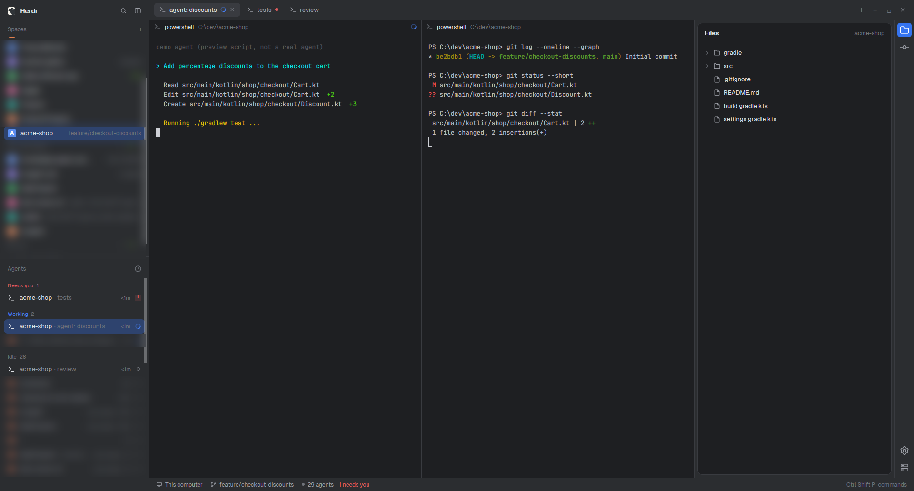

# IntelliJ (Herdr)

A [Herdr](https://herdr.dev) layout that is mostly a new look: Herdr's own window in the JetBrains New UI colors (Dark or Light, following your system or Herdr's Appearance setting), with JetBrains Mono and flat panes. The only layout change is an IntelliJ-style icon stripe on the right for Files, Changes, Settings and Add machine.

To add it, ask the agent in your Herdr window to add this layout, or copy `layouts/`, `themes/` and `mods/`
into `~/.config/herdr-app/` and run `herdr-app do layout.switch --name intellij-herdr`.
Copy `themes/` too: without it the layout uses Herdr's default colors.

`RECIPE.md` is the brief to build it from scratch. `NOTICE.md` lists where the colors and icons come from.
